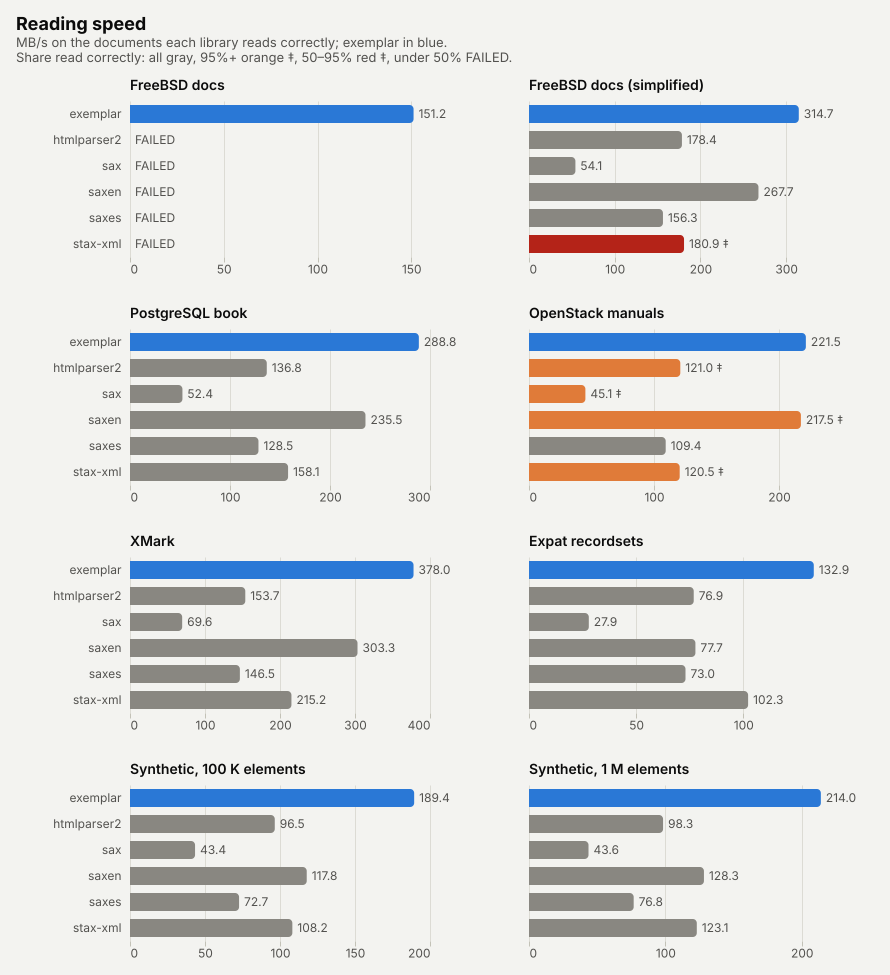
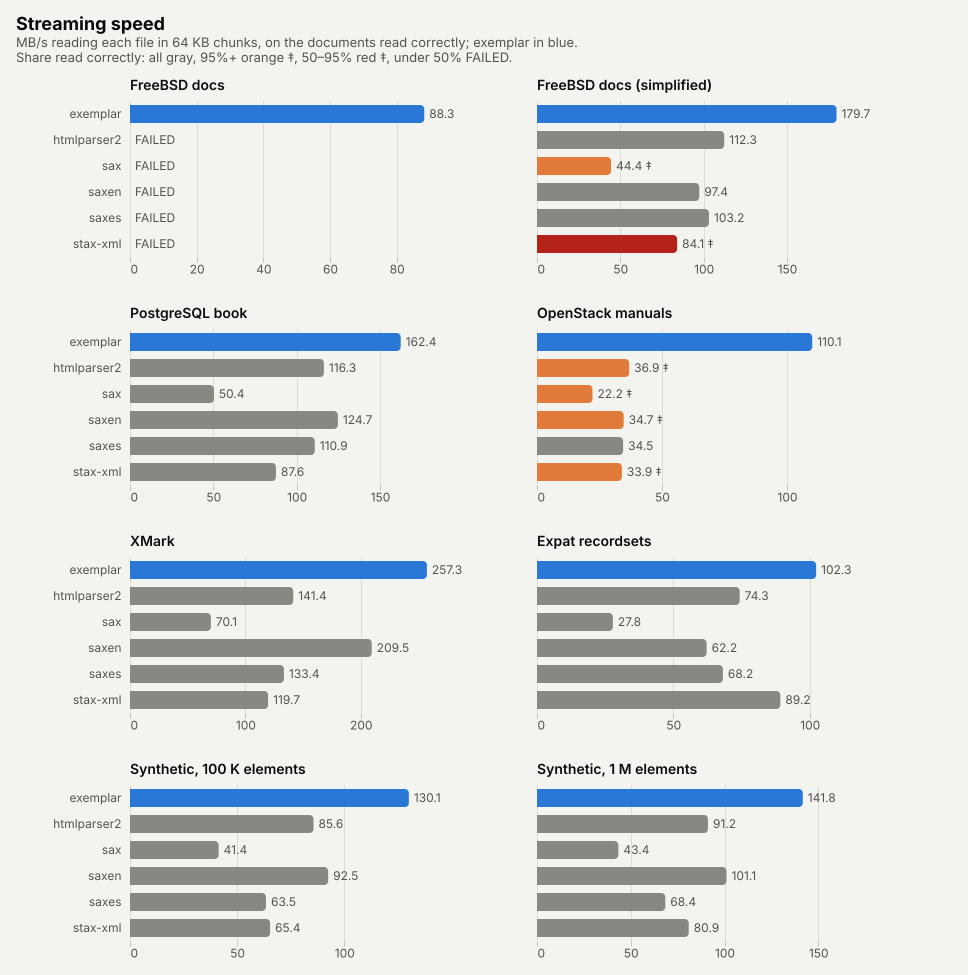
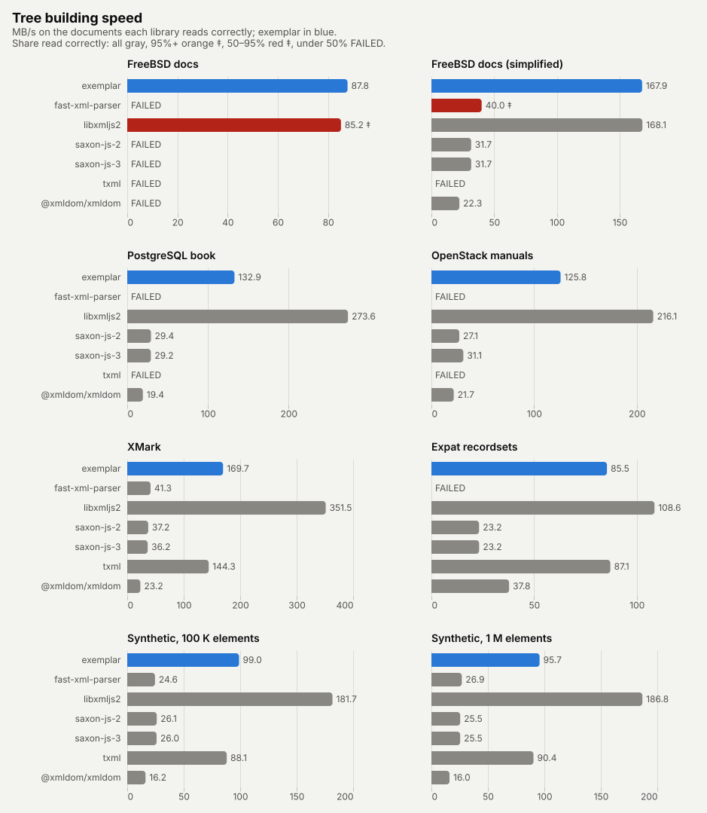
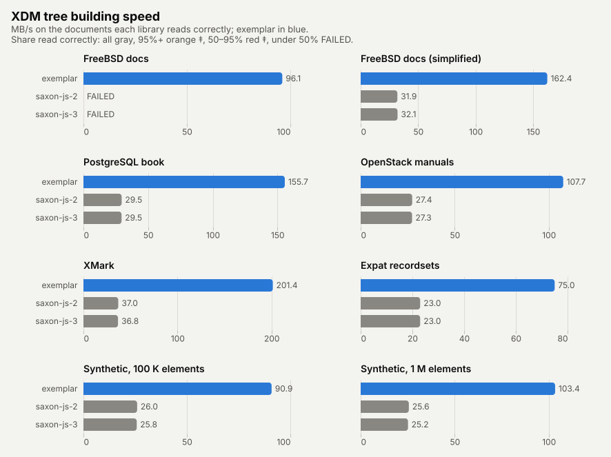
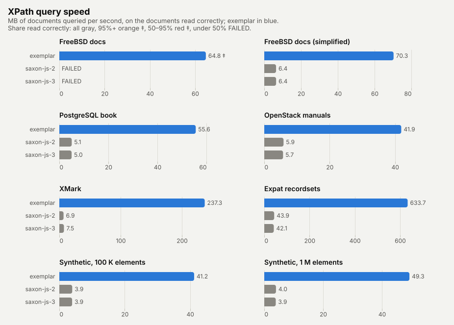
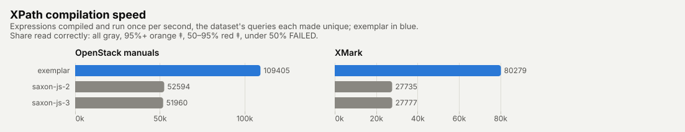
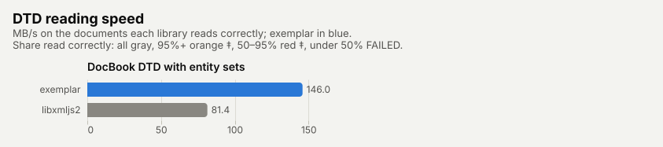
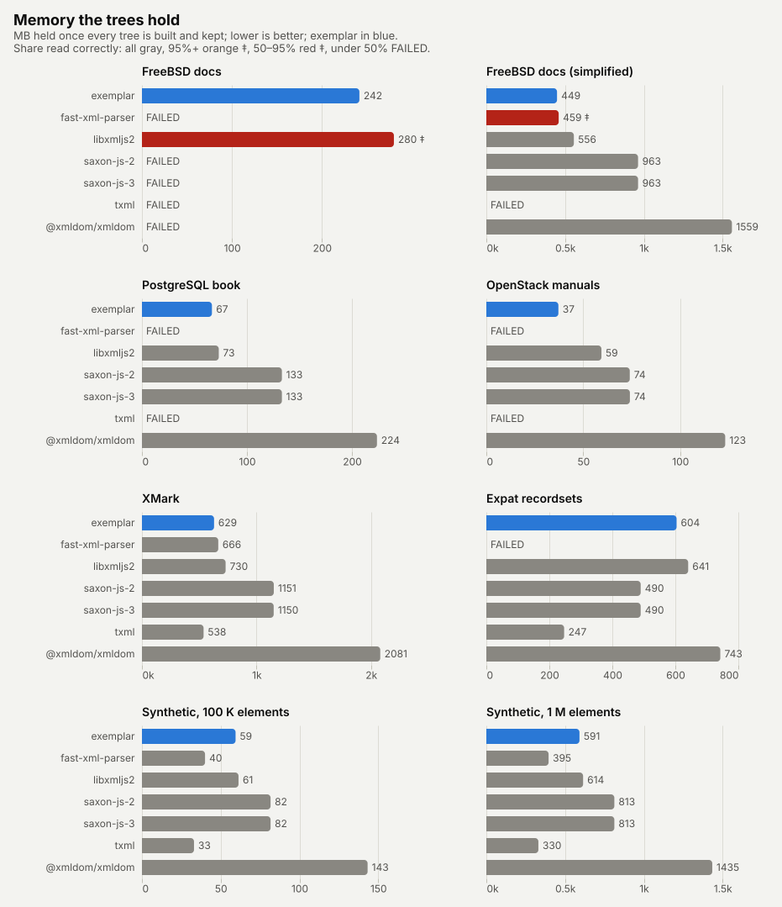
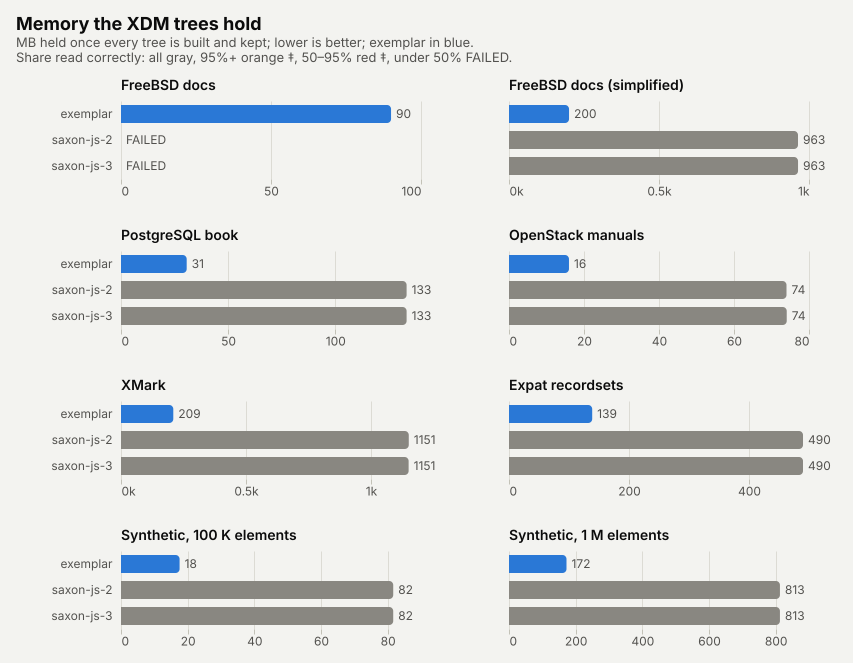
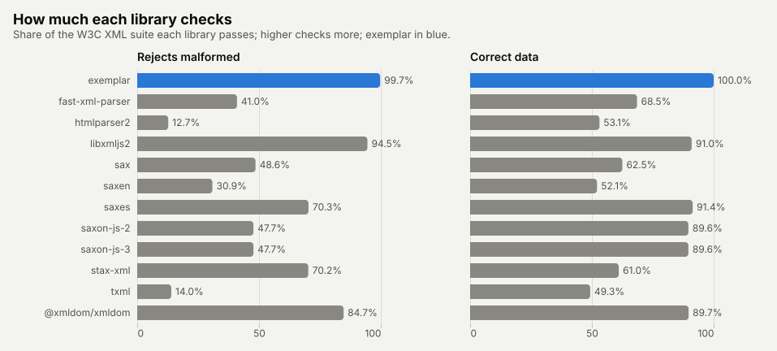

# Benchmarks

2026-11-19 · AMD Ryzen 9 7900 12-Core Processor, 4 cores, 8 GB, linux x64 · Node 24.13.1, V8 13.6.233.17-node.40 · commit 56a5fc8 · best of 3 rounds

[At a glance](#at-a-glance) · [How much each library checks](#how-much-each-library-checks) · [Datasets](#datasets) · [FreeBSD docs](#freebsd-docs) · [FreeBSD docs (simplified)](#freebsd-docs-simplified) · [PostgreSQL book](#postgresql-book) · [OpenStack manuals](#openstack-manuals) · [XMark](#xmark) · [Expat recordsets](#expat-recordsets) · [DocBook DTD with entity sets](#docbook-dtd-with-entity-sets) · [Synthetic, 100 K elements](#synthetic-100-k-elements) · [Synthetic, 1 M elements](#synthetic-1-m-elements)

## At a glance

Speeds are in MB of input per second, from the best of 3 rounds, over the documents each library read correctly. A library that read only part of a dataset correctly is timed on that part, so its speed and exemplar's cover different documents. ‡ marks a library that read at least half of the data, by size, but not all of it; in the charts its bars are orange from 95% and red below. FAILED marks one that read less than half, whose speed would say little about the dataset. exemplar's bars are always blue, and – marks a workload the library does not have.

In each workload, a library:

- `walk` parses and visits every event, reading nothing.
- `read` reads every element name, attribute and text.
- `stream` reads the same from a file in 64 KB chunks.
- `small` reads documents of 2–20 KB, which shows the cost per document.
- `tree` builds the library's own tree.
- `xdm` builds an XDM tree, the data model XPath, XQuery and XSLT run on.
- `xpath` runs a set of XPath queries over each document, parsed beforehand: the XMark queries on XMark, general ones elsewhere.
- `axes` times tree walks along every axis one by one, over the document parsed beforehand: XMark's names only.
- `compile` compiles each of the dataset's XPath queries 200 times, every copy made unique so that no cache answers, and runs it over a one-element document; shown in expressions compiled per second.
- `write` serializes events it read beforehand.
- `dtd` reads a one-element document with its large DTD, counting the DTD with the document.

### Reading, MB/s

| Dataset | exemplar | htmlparser2 | sax | saxen | saxes | stax-xml |
| --- | ---: | ---: | ---: | ---: | ---: | ---: |
| [FreeBSD docs](#freebsd-docs) | 151.2 | FAILED | FAILED | FAILED | FAILED | FAILED |
| [FreeBSD docs (simplified)](#freebsd-docs-simplified) | 314.7 | 178.4 | 54.1 | 267.7 | 156.3 | 180.9 ‡ |
| [PostgreSQL book](#postgresql-book) | 288.8 | 136.8 | 52.4 | 235.5 | 128.5 | 158.1 |
| [OpenStack manuals](#openstack-manuals) | 221.5 | 121.0 ‡ | 45.1 ‡ | 217.5 ‡ | 109.4 | 120.5 ‡ |
| [XMark](#xmark) | 378.0 | 153.7 | 69.6 | 303.3 | 146.5 | 215.2 |
| [Expat recordsets](#expat-recordsets) | 132.9 | 76.9 | 27.9 | 77.7 | 73.0 | 102.3 |
| [Synthetic, 100 K elements](#synthetic-100-k-elements) | 189.4 | 96.5 | 43.4 | 117.8 | 72.7 | 108.2 |
| [Synthetic, 1 M elements](#synthetic-1-m-elements) | 214.0 | 98.3 | 43.6 | 128.3 | 76.8 | 123.1 |

### Streaming from a file, MB/s

| Dataset | exemplar | htmlparser2 | sax | saxen | saxes | stax-xml |
| --- | ---: | ---: | ---: | ---: | ---: | ---: |
| [FreeBSD docs](#freebsd-docs) | 88.3 | FAILED | FAILED | FAILED | FAILED | FAILED |
| [FreeBSD docs (simplified)](#freebsd-docs-simplified) | 179.7 | 112.3 | 44.4 ‡ | 97.4 | 103.2 | 84.1 ‡ |
| [PostgreSQL book](#postgresql-book) | 162.4 | 116.3 | 50.4 | 124.7 | 110.9 | 87.6 |
| [OpenStack manuals](#openstack-manuals) | 110.1 | 36.9 ‡ | 22.2 ‡ | 34.7 ‡ | 34.5 | 33.9 ‡ |
| [XMark](#xmark) | 257.3 | 141.4 | 70.1 | 209.5 | 133.4 | 119.7 |
| [Expat recordsets](#expat-recordsets) | 102.3 | 74.3 | 27.8 | 62.2 | 68.2 | 89.2 |
| [Synthetic, 100 K elements](#synthetic-100-k-elements) | 130.1 | 85.6 | 41.4 | 92.5 | 63.5 | 65.4 |
| [Synthetic, 1 M elements](#synthetic-1-m-elements) | 141.8 | 91.2 | 43.4 | 101.1 | 68.4 | 80.9 |

### Building trees, MB/s

| Dataset | exemplar | fast-xml-parser | libxmljs2 | saxon-js-2 | saxon-js-3 | txml | @xmldom/xmldom |
| --- | ---: | ---: | ---: | ---: | ---: | ---: | ---: |
| [FreeBSD docs](#freebsd-docs) | 87.8 | FAILED | 85.2 ‡ | FAILED | FAILED | FAILED | FAILED |
| [FreeBSD docs (simplified)](#freebsd-docs-simplified) | 167.9 | 40.0 ‡ | 168.1 | 31.7 | 31.7 | FAILED | 22.3 |
| [PostgreSQL book](#postgresql-book) | 132.9 | FAILED | 273.6 | 29.4 | 29.2 | FAILED | 19.4 |
| [OpenStack manuals](#openstack-manuals) | 125.8 | FAILED | 216.1 | 27.1 | 31.1 | FAILED | 21.7 |
| [XMark](#xmark) | 169.7 | 41.3 | 351.5 | 37.2 | 36.2 | 144.3 | 23.2 |
| [Expat recordsets](#expat-recordsets) | 85.5 | FAILED | 108.6 | 23.2 | 23.2 | 87.1 | 37.8 |
| [Synthetic, 100 K elements](#synthetic-100-k-elements) | 99.0 | 24.6 | 181.7 | 26.1 | 26.0 | 88.1 | 16.2 |
| [Synthetic, 1 M elements](#synthetic-1-m-elements) | 95.7 | 26.9 | 186.8 | 25.5 | 25.5 | 90.4 | 16.0 |

### Building XDM trees, MB/s

| Dataset | exemplar | saxon-js-2 | saxon-js-3 |
| --- | ---: | ---: | ---: |
| [FreeBSD docs](#freebsd-docs) | 96.1 | FAILED | FAILED |
| [FreeBSD docs (simplified)](#freebsd-docs-simplified) | 162.4 | 31.9 | 32.1 |
| [PostgreSQL book](#postgresql-book) | 155.7 | 29.5 | 29.5 |
| [OpenStack manuals](#openstack-manuals) | 107.7 | 27.4 | 27.3 |
| [XMark](#xmark) | 201.4 | 37.0 | 36.8 |
| [Expat recordsets](#expat-recordsets) | 75.0 | 23.0 | 23.0 |
| [Synthetic, 100 K elements](#synthetic-100-k-elements) | 90.9 | 26.0 | 25.8 |
| [Synthetic, 1 M elements](#synthetic-1-m-elements) | 103.4 | 25.6 | 25.2 |

### Querying with XPath, MB/s

| Dataset | exemplar | saxon-js-2 | saxon-js-3 |
| --- | ---: | ---: | ---: |
| [FreeBSD docs](#freebsd-docs) | 64.8 ‡ | FAILED | FAILED |
| [FreeBSD docs (simplified)](#freebsd-docs-simplified) | 70.3 | 6.4 | 6.4 |
| [PostgreSQL book](#postgresql-book) | 55.6 | 5.1 | 5.0 |
| [OpenStack manuals](#openstack-manuals) | 41.9 | 5.9 | 5.7 |
| [XMark](#xmark) | 237.3 | 6.9 | 7.5 |
| [Expat recordsets](#expat-recordsets) | 633.7 | 43.9 | 42.1 |
| [Synthetic, 100 K elements](#synthetic-100-k-elements) | 41.2 | 3.9 | 3.9 |
| [Synthetic, 1 M elements](#synthetic-1-m-elements) | 49.3 | 4.0 | 3.9 |

### Compiling XPath, expressions per second

| Dataset | exemplar | saxon-js-2 | saxon-js-3 |
| --- | ---: | ---: | ---: |
| [OpenStack manuals](#openstack-manuals) | 109405 | 52594 | 51960 |
| [XMark](#xmark) | 80279 | 27735 | 27777 |

### Reading DTDs, MB/s

| Dataset | exemplar | libxmljs2 |
| --- | ---: | ---: |
| [DocBook DTD with entity sets](#docbook-dtd-with-entity-sets) | 146.0 | 81.4 |

### Memory the trees hold

MB still in use once every document's tree has been built and kept: heap, native memory V8 is told of, and native memory a library reports itself. ‡ and FAILED mean the same as for speeds: a library that failed some documents holds fewer trees.

| Dataset | exemplar | fast-xml-parser | libxmljs2 | saxon-js-2 | saxon-js-3 | txml | @xmldom/xmldom |
| --- | ---: | ---: | ---: | ---: | ---: | ---: | ---: |
| [FreeBSD docs](#freebsd-docs) | 242 | FAILED | 280 ‡ | FAILED | FAILED | FAILED | FAILED |
| [FreeBSD docs (simplified)](#freebsd-docs-simplified) | 449 | 459 ‡ | 556 | 963 | 963 | FAILED | 1559 |
| [PostgreSQL book](#postgresql-book) | 67 | FAILED | 73 | 133 | 133 | FAILED | 224 |
| [OpenStack manuals](#openstack-manuals) | 37 | FAILED | 59 | 74 | 74 | FAILED | 123 |
| [XMark](#xmark) | 629 | 666 | 730 | 1151 | 1150 | 538 | 2081 |
| [Expat recordsets](#expat-recordsets) | 604 | FAILED | 641 | 490 | 490 | 247 | 743 |
| [Synthetic, 100 K elements](#synthetic-100-k-elements) | 59 | 40 | 61 | 82 | 82 | 33 | 143 |
| [Synthetic, 1 M elements](#synthetic-1-m-elements) | 591 | 395 | 614 | 813 | 813 | 330 | 1435 |

### Memory the XDM trees hold

MB still in use once every document's tree has been built and kept: heap, native memory V8 is told of, and native memory a library reports itself. ‡ and FAILED mean the same as for speeds: a library that failed some documents holds fewer trees.

| Dataset | exemplar | saxon-js-2 | saxon-js-3 |
| --- | ---: | ---: | ---: |
| [FreeBSD docs](#freebsd-docs) | 90 | FAILED | FAILED |
| [FreeBSD docs (simplified)](#freebsd-docs-simplified) | 200 | 963 | 963 |
| [PostgreSQL book](#postgresql-book) | 31 | 133 | 133 |
| [OpenStack manuals](#openstack-manuals) | 16 | 74 | 74 |
| [XMark](#xmark) | 209 | 1151 | 1151 |
| [Expat recordsets](#expat-recordsets) | 139 | 490 | 490 |
| [Synthetic, 100 K elements](#synthetic-100-k-elements) | 18 | 82 | 82 |
| [Synthetic, 1 M elements](#synthetic-1-m-elements) | 172 | 813 | 813 |

## How much each library checks

A library that checks less of XML can be faster. From the conformance reports: "Rejects malformed" is the share of the not-well-formed test documents a library rejects, and "Correct data" the share of the expected outputs it matches.

| Library | Rejects malformed | Correct data |
| --- | ---: | ---: |
| exemplar | 99.7% | 100.0% |
| fast-xml-parser | 41.0% | 68.5% |
| htmlparser2 | 12.7% | 53.1% |
| libxmljs2 | 94.5% | 91.0% |
| sax | 48.6% | 62.5% |
| saxen | 30.9% | 52.1% |
| saxes | 70.3% | 91.4% |
| saxon-js-2 | 47.7% | 89.6% |
| saxon-js-3 | 47.7% | 89.6% |
| stax-xml | 70.2% | 61.0% |
| txml | 14.0% | 49.3% |
| @xmldom/xmldom | 84.7% | 89.7% |

## Datasets

Preparing a dataset checks every document with the JDK's Xerces and keeps only those it accepts.

| Dataset | Documents | MB | Left out in preparation | Version | Licence |
| --- | ---: | ---: | ---: | --- | --- |
| [FreeBSD docs](#freebsd-docs) | 1,830 | 40.7 | 734 | release/12.2.0 (6525fd04), LF turned into CRLF | FreeBSD Documentation License |
| [FreeBSD docs (simplified)](#freebsd-docs-simplified) | 1,715 | 92.6 | 38 | release/12.2.0 (6525fd04), entities resolved and DOCTYPE removed by xmllint | FreeBSD Documentation License |
| [PostgreSQL book](#postgresql-book) | 1 | 12.2 | 0 | REL_18_0, assembled into one document by xmllint | PostgreSQL Licence |
| [OpenStack manuals](#openstack-manuals) | 966 | 6.5 | 50 | juno-eol (304d14ff) | Apache-2.0, CC BY 3.0 and CC BY-SA 3.0, by book |
| [XMark](#xmark) | 1 | 116.5 | 0 | xmlgen from CWI, factor 1 | Unclear; generated locally and never redistributed |
| [Expat recordsets](#expat-recordsets) | 2 | 66.0 | 0 | libexpat b8fedbbf | MIT |
| [DocBook DTD with entity sets](#docbook-dtd-with-entity-sets) | 20 | 46.2 | 0 | release/12.2.0 (6525fd04); xmlcharent 0.3 | FreeBSD Documentation License; xmlcharent under its OASIS notice |
| [Synthetic, 100 K elements](#synthetic-100-k-elements) | 1 | 6.2 | 0 | seed 1 | generated |
| [Synthetic, 1 M elements](#synthetic-1-m-elements) | 1 | 61.7 | 0 | seed 1 | generated |

## FreeBSD docs

- The FreeBSD documentation as published at release 12.2.0, with its LF line endings turned into CRLF, so that reading normalizes them.
- Internal subsets, eight encodings including Japanese in EUC-JP, and documents of every size.
- Read standalone, as every dataset is: no library reads the external DocBook and FreeBSD DTDs, so references to the entities they declare, such as `&os;`, are not expanded.
- Where such a reference makes a document malformed, preparation leaves the document out; where an unread part of the DTD could declare it, the reference is skipped, as the XML specification allows.

1,830 documents, 40.7 MB. Speeds are in MB/s, except `compile`, in expressions per second.

| Library | Reads correctly | `walk` | `read` | `stream` | `small` | `tree` | `xdm` | `xpath` | `write` | Tree MB | XDM MB |
| --- | ---: | ---: | ---: | ---: | ---: | ---: | ---: | ---: | ---: | ---: | ---: |
| exemplar | 100% | 205.7 | 151.2 | 88.3 | 96.5 | 87.8 | 96.1 | 64.8 ‡ | 133.2 | 242 | 90 |
| fast-xml-parser | 11% | – | – | – | – | FAILED | – | – | – | FAILED | – |
| htmlparser2 | <1% | FAILED | FAILED | FAILED | FAILED | – | – | – | – | – | – |
| libxmljs2 | 84% | – | – | – | – | 85.2 ‡ | – | – | – | 280 ‡ | – |
| sax | <1% | FAILED | FAILED | FAILED | FAILED | – | – | – | – | – | – |
| saxen | <1% | FAILED | FAILED | FAILED | FAILED | – | – | – | – | – | – |
| saxes | 37% | FAILED | FAILED | FAILED | FAILED | – | – | – | – | – | – |
| saxon-js-2 | 14% | – | – | – | – | FAILED | FAILED | FAILED | – | FAILED | FAILED |
| saxon-js-3 | 14% | – | – | – | – | FAILED | FAILED | FAILED | – | FAILED | FAILED |
| stax-xml | <1% | FAILED | FAILED | FAILED | FAILED | – | – | – | FAILED | – | – |
| txml | <1% | – | – | – | – | FAILED | – | – | – | FAILED | – |
| @xmldom/xmldom | 37% | – | – | – | – | FAILED | – | – | – | FAILED | – |

Raw measurements

Times here cover every document the workload reads, including those a library throws on or reads wrongly.

| Library | Workload | Best ms | Median ms | Noise | Threw on | Wrong output | Count differs | ns/event | Retained MB |
| --- | --- | --- | --- | --- | --- | --- | --- | --- | --- |
| exemplar 0.2.0 | walk | 198 | 200 | 4.4% | 0 of 1,830 | 0 | n/a | 123 | n/a |
| htmlparser2 12.0.0 | walk | 244 | 244 | 3.0% | 0 of 1,830 | 877 | n/a | 152 | n/a |
| sax 1.6.1 | walk | 383 | 387 | 3.9% | 1,556 of 1,830 | 196 | n/a | 238 | n/a |
| saxen 11.2.0 | walk | 96 | 98 | 3.0% | 0 of 1,830 | 877 | n/a | 60 | n/a |
| saxes 6.0.0 | walk | 138 | 138 | 0.4% | 1,571 of 1,830 | 0 | n/a | 86 | n/a |
| stax-xml 1.1.2 | walk | 122 | 125 | 4.3% | 1,571 of 1,830 | 189 | n/a | 76 | n/a |
| exemplar 0.2.0 | read | 269 | 271 | 2.8% | 0 of 1,830 | 0 | 0 | 167 | n/a |
| htmlparser2 12.0.0 | read | 267 | 268 | 2.3% | 0 of 1,830 | 877 | 1,807 | 166 | n/a |
| sax 1.6.1 | read | 399 | 401 | 2.3% | 1,556 of 1,830 | 196 | 268 | 248 | n/a |
| saxen 11.2.0 | read | 180 | 183 | 7.8% | 0 of 1,830 | 877 | 1,807 | 112 | n/a |
| saxes 6.0.0 | read | 159 | 163 | 3.6% | 1,571 of 1,830 | 0 | 0 | 99 | n/a |
| stax-xml 1.1.2 | read | 137 | 138 | 3.4% | 1,571 of 1,830 | 189 | 253 | 85 | n/a |
| exemplar 0.2.0 | tree | 464 | 468 | 1.7% | 0 of 1,830 | 0 | n/a | 288 | 242 |
| fast-xml-parser 5.11.2 | tree | 721 | 730 | 1.3% | 128 of 1,830 | 436 | n/a | 448 | 189 |
| libxmljs2 0.37.0 | tree | 432 | 433 | 0.4% | 512 of 1,830 | 7 | n/a | 269 | 280 |
| saxon-js-2 2.7.0 | tree | 351 | 352 | 1.8% | 1,578 of 1,830 | 0 | n/a | 218 | 84 |
| saxon-js-3 3.0.0-beta2 | tree | 386 | 387 | 1.7% | 1,578 of 1,830 | 0 | n/a | 240 | 84 |
| txml 6.0.3 | tree | 89 | 90 | 2.9% | 259 of 1,830 | 711 | n/a | 55 | 84 |
| @xmldom/xmldom 0.9.12 | tree | 987 | 987 | 0.5% | 1,571 of 1,830 | 0 | n/a | 614 | 343 |
| exemplar 0.2.0 | xdm | 423 | 425 | 4.7% | 0 of 1,830 | 0 | n/a | 263 | 90 |
| saxon-js-2 2.7.0 | xdm | 351 | 353 | 0.9% | 1,578 of 1,830 | 0 | n/a | 218 | 84 |
| saxon-js-3 3.0.0-beta2 | xdm | 389 | 390 | 0.4% | 1,578 of 1,830 | 0 | n/a | 242 | 84 |
| exemplar 0.2.0 | xpath | 446 | 447 | 0.8% | 706 of 1,830 | 0 | 0 | 277 | n/a |
| saxon-js-2 2.7.0 | xpath | 1032 | 1034 | 2.3% | 1,578 of 1,830 | 0 | 0 | 641 | n/a |
| saxon-js-3 3.0.0-beta2 | xpath | 1045 | 1054 | 1.1% | 1,578 of 1,830 | 0 | 0 | 650 | n/a |
| exemplar 0.2.0 | stream | 461 | 463 | 3.3% | 0 of 1,830 | 0 | 0 | 287 | n/a |
| htmlparser2 12.0.0 | stream | 398 | 422 | 8.1% | 947 of 1,830 | 877 | 866 | 247 | n/a |
| sax 1.6.1 | stream | 584 | 588 | 5.3% | 1,628 of 1,830 | 196 | 196 | 363 | n/a |
| saxen 11.2.0 | stream | 402 | 408 | 4.8% | 947 of 1,830 | 877 | 866 | 250 | n/a |
| saxes 6.0.0 | stream | 355 | 357 | 3.4% | 1,635 of 1,830 | 0 | 0 | 220 | n/a |
| stax-xml 1.1.2 | stream | 339 | 339 | 4.2% | 1,635 of 1,830 | 189 | 189 | 211 | n/a |
| exemplar 0.2.0 | small | 74 | 75 | 5.5% | 0 of 991 | 0 | 0 | 46 | n/a |
| htmlparser2 12.0.0 | small | 58 | 60 | 3.7% | 0 of 991 | 877 | 990 | 36 | n/a |
| sax 1.6.1 | small | 47 | 49 | 6.8% | 903 of 991 | 196 | 87 | 29 | n/a |
| saxen 11.2.0 | small | 45 | 45 | 0.3% | 0 of 991 | 877 | 990 | 28 | n/a |
| saxes 6.0.0 | small | 25 | 26 | 4.7% | 905 of 991 | 0 | 0 | 16 | n/a |
| stax-xml 1.1.2 | small | 26 | 27 | 6.2% | 905 of 991 | 189 | 85 | 16 | n/a |
| exemplar 0.2.0 | write | 305 | 308 | 3.0% | 0 of 1,830 | 0 | n/a | 190 | n/a |
| stax-xml 1.1.2 | write | 228 | 229 | 0.9% | 1,711 of 1,830 | 189 | n/a | 142 | n/a |

fast-xml-parser first differs in ` bn_BD.UTF-8/articles/new-users/article.xml `: ` at 27353: got "&amp;nbsp; Associates, 1993,&#10;      I", expected " Associates, 1993,&#10;      ISBN 0-9371" `

htmlparser2 first differs in ` bn_BD.UTF-8/articles/explaining-bsd/article.xml `: ` at 107: got "3;&#10;  <info><title>BSD কি, কেন,&#13;&", expected "0;  <info><title>BSD কি, কেন,&#10;      " `

libxmljs2 first differs in ` de_DE.ISO8859-1/htdocs/art.xml `: rejects it

sax first differs in ` bn_BD.UTF-8/articles/explaining-bsd/article.xml `: ` at 107: got "3;&#10;  <info><title>BSD কি, কেন,&#13;&", expected "0;  <info><title>BSD কি, কেন,&#10;      " `

saxen first differs in ` bn_BD.UTF-8/articles/explaining-bsd/article.xml `: ` at 107: got "3;&#10;  <info><title>BSD কি, কেন,&#13;&", expected "0;  <info><title>BSD কি, কেন,&#10;      " `

saxes first differs in ` bn_BD.UTF-8/articles/new-users/article.xml `: rejects it

saxon-js-2 first differs in ` bn_BD.UTF-8/articles/new-users/article.xml `: rejects it

saxon-js-3 first differs in ` bn_BD.UTF-8/articles/new-users/article.xml `: rejects it

stax-xml first differs in ` bn_BD.UTF-8/articles/explaining-bsd/article.xml `: ` at 107: got "3;&#10;  <info><title>BSD কি, কেন,&#13;&", expected "0;  <info><title>BSD কি, কেন,&#10;      " `

txml first differs in ` bn_BD.UTF-8/articles/explaining-bsd/article.xml `: rejects it

@xmldom/xmldom first differs in ` bn_BD.UTF-8/articles/new-users/article.xml `: rejects it

## FreeBSD docs (simplified)

- The FreeBSD docs documents rewritten by xmllint as plain XML, so that every library can read the same content. As published, they need DTDs that most libraries cannot read, so those libraries fail on most documents.
- xmllint first checks each document with its DTDs, read through the DocBook and FreeBSD catalogs, and replaces every entity with its text.
- The DOCTYPE, with its internal subset, is removed.
- Every document is re-encoded as UTF-8, the Japanese ones in EUC-JP included.
- Each namespace is declared once, where it comes into force, rather than on every element, as the DTDs' attribute defaults would give it.
- Line endings are LF, as reading normalizes them.
- Left out, and counted in preparation: documents xmllint finds malformed when read with their DTDs, or that use entities no DTD declares, or that need a DTD the archive does not hold, and documents with references Xerces cannot resolve once the DOCTYPE is gone. Documents without a DOCTYPE are not rewritten: most are parts of books that other documents include.

1,715 documents, 92.6 MB. Speeds are in MB/s, except `compile`, in expressions per second.

| Library | Reads correctly | `walk` | `read` | `stream` | `small` | `tree` | `xdm` | `xpath` | `write` | Tree MB | XDM MB |
| --- | ---: | ---: | ---: | ---: | ---: | ---: | ---: | ---: | ---: | ---: | ---: |
| exemplar | 100% | 389.9 | 314.7 | 179.7 | 262.4 | 167.9 | 162.4 | 70.3 | 143.8 | 449 | 200 |
| fast-xml-parser | 76% | – | – | – | – | 40.0 ‡ | – | – | – | 459 ‡ | – |
| htmlparser2 | 100% | 192.3 | 178.4 | 112.3 | 124.5 | – | – | – | – | – | – |
| libxmljs2 | 100% | – | – | – | – | 168.1 | – | – | – | 556 | – |
| sax | 100% | 56.5 | 54.1 | 44.4 ‡ | 50.8 | – | – | – | – | – | – |
| saxen | 100% | 417.1 | 267.7 | 97.4 | 209.7 | – | – | – | – | – | – |
| saxes | 100% | 191.5 | 156.3 | 103.2 | 107.3 | – | – | – | – | – | – |
| saxon-js-2 | 100% | – | – | – | – | 31.7 | 31.9 | 6.4 | – | 963 | 963 |
| saxon-js-3 | 100% | – | – | – | – | 31.7 | 32.1 | 6.4 | – | 963 | 963 |
| stax-xml | 76% | 227.3 ‡ | 180.9 ‡ | 84.1 ‡ | 116.3 ‡ | – | – | – | 91.0 ‡ | – | – |
| txml | 17% | – | – | – | – | FAILED | – | – | – | FAILED | – |
| @xmldom/xmldom | 100% | – | – | – | – | 22.3 | – | – | – | 1559 | – |

Raw measurements

Times here cover every document the workload reads, including those a library throws on or reads wrongly.

| Library | Workload | Best ms | Median ms | Noise | Threw on | Wrong output | Count differs | ns/event | Retained MB |
| --- | --- | --- | --- | --- | --- | --- | --- | --- | --- |
| exemplar 0.2.0 | walk | 238 | 239 | 0.6% | 0 of 1,715 | 0 | n/a | 65 | n/a |
| htmlparser2 12.0.0 | walk | 482 | 484 | 1.3% | 0 of 1,715 | 0 | n/a | 133 | n/a |
| sax 1.6.1 | walk | 1639 | 1640 | 0.9% | 0 of 1,715 | 0 | n/a | 451 | n/a |
| saxen 11.2.0 | walk | 222 | 224 | 4.4% | 0 of 1,715 | 0 | n/a | 61 | n/a |
| saxes 6.0.0 | walk | 484 | 486 | 2.4% | 0 of 1,715 | 0 | n/a | 133 | n/a |
| stax-xml 1.1.2 | walk | 412 | 418 | 1.8% | 0 of 1,715 | 44 | n/a | 113 | n/a |
| exemplar 0.2.0 | read | 295 | 296 | 0.7% | 0 of 1,715 | 0 | 0 | 81 | n/a |
| htmlparser2 12.0.0 | read | 519 | 523 | 1.0% | 0 of 1,715 | 0 | 0 | 143 | n/a |
| sax 1.6.1 | read | 1711 | 1724 | 3.5% | 0 of 1,715 | 0 | 0 | 471 | n/a |
| saxen 11.2.0 | read | 346 | 349 | 1.1% | 0 of 1,715 | 0 | 0 | 95 | n/a |
| saxes 6.0.0 | read | 593 | 596 | 1.9% | 0 of 1,715 | 0 | 0 | 163 | n/a |
| stax-xml 1.1.2 | read | 516 | 518 | 4.7% | 0 of 1,715 | 44 | 44 | 142 | n/a |
| exemplar 0.2.0 | tree | 552 | 555 | 1.5% | 0 of 1,715 | 0 | n/a | 152 | 449 |
| fast-xml-parser 5.11.2 | tree | 2236 | 2272 | 3.0% | 4 of 1,715 | 43 | n/a | 615 | 459 |
| libxmljs2 0.37.0 | tree | 551 | 554 | 0.5% | 0 of 1,715 | 0 | n/a | 152 | 556 |
| saxon-js-2 2.7.0 | tree | 2925 | 2935 | 1.7% | 0 of 1,715 | 0 | n/a | 805 | 963 |
| saxon-js-3 3.0.0-beta2 | tree | 2923 | 2945 | 1.2% | 0 of 1,715 | 0 | n/a | 804 | 963 |
| txml 6.0.3 | tree | 86 | 86 | 6.7% | 262 of 1,715 | 4 | n/a | 24 | 77 |
| @xmldom/xmldom 0.9.12 | tree | 4161 | 4173 | 0.9% | 0 of 1,715 | 0 | n/a | 1144 | 1559 |
| exemplar 0.2.0 | xdm | 571 | 573 | 0.9% | 0 of 1,715 | 0 | n/a | 157 | 200 |
| saxon-js-2 2.7.0 | xdm | 2900 | 2906 | 0.4% | 0 of 1,715 | 0 | n/a | 798 | 963 |
| saxon-js-3 3.0.0-beta2 | xdm | 2888 | 2895 | 1.3% | 0 of 1,715 | 0 | n/a | 794 | 963 |
| exemplar 0.2.0 | xpath | 1318 | 1329 | 3.2% | 0 of 1,715 | 0 | 0 | 362 | n/a |
| saxon-js-2 2.7.0 | xpath | 14442 | 14444 | 1.0% | 0 of 1,715 | 0 | 0 | 3972 | n/a |
| saxon-js-3 3.0.0-beta2 | xpath | 14383 | 14589 | 1.5% | 0 of 1,715 | 0 | 0 | 3956 | n/a |
| exemplar 0.2.0 | stream | 516 | 522 | 1.3% | 0 of 1,715 | 0 | 0 | 142 | n/a |
| htmlparser2 12.0.0 | stream | 825 | 834 | 2.9% | 0 of 1,715 | 0 | 0 | 227 | n/a |
| sax 1.6.1 | stream | 2041 | 2067 | 1.8% | 1 of 1,715 | 0 | 0 | 561 | n/a |
| saxen 11.2.0 | stream | 952 | 955 | 0.9% | 0 of 1,715 | 0 | 0 | 262 | n/a |
| saxes 6.0.0 | stream | 899 | 911 | 3.7% | 0 of 1,715 | 0 | 0 | 247 | n/a |
| stax-xml 1.1.2 | stream | 1047 | 1082 | 5.5% | 0 of 1,715 | 44 | 44 | 288 | n/a |
| exemplar 0.2.0 | small | 24 | 24 | 0.8% | 0 of 867 | 0 | 0 | 7 | n/a |
| htmlparser2 12.0.0 | small | 51 | 52 | 4.7% | 0 of 867 | 0 | 0 | 14 | n/a |
| sax 1.6.1 | small | 124 | 124 | 2.3% | 0 of 867 | 0 | 0 | 34 | n/a |
| saxen 11.2.0 | small | 30 | 36 | 23.8% | 0 of 867 | 0 | 0 | 8 | n/a |
| saxes 6.0.0 | small | 59 | 59 | 1.4% | 0 of 867 | 0 | 0 | 16 | n/a |
| stax-xml 1.1.2 | small | 54 | 55 | 2.1% | 0 of 867 | 44 | 14 | 15 | n/a |
| exemplar 0.2.0 | write | 644 | 652 | 1.5% | 0 of 1,715 | 0 | n/a | 177 | n/a |
| stax-xml 1.1.2 | write | 1063 | 1076 | 2.0% | 0 of 1,715 | 44 | n/a | 292 | n/a |

fast-xml-parser first differs in ` de_DE.ISO8859-1/books/handbook/book.xml `: rejects it

stax-xml first differs in ` de_DE.ISO8859-1/books/handbook/book.xml `: ` at 836236: got "?>&#10;&#10;  <sect1 xml:id=\"linuxemu-ad", expected "\n  ?>&#10;&#10;  <sect1 xml:id=\"linuxemu" `

txml first differs in ` bn_BD.UTF-8/articles/explaining-bsd/article.xml `: rejects it

## PostgreSQL book

1 document, 12.2 MB. Speeds are in MB/s, except `compile`, in expressions per second.

| Library | Reads correctly | `walk` | `read` | `stream` | `tree` | `xdm` | `xpath` | `write` | Tree MB | XDM MB |
| --- | ---: | ---: | ---: | ---: | ---: | ---: | ---: | ---: | ---: | ---: |
| exemplar | 100% | 378.6 | 288.8 | 162.4 | 132.9 | 155.7 | 55.6 | 144.1 | 67 | 31 |
| fast-xml-parser | 0% | – | – | – | FAILED | – | – | – | FAILED | – |
| htmlparser2 | 100% | 142.8 | 136.8 | 116.3 | – | – | – | – | – | – |
| libxmljs2 | 100% | – | – | – | 273.6 | – | – | – | 73 | – |
| sax | 100% | 55.6 | 52.4 | 50.4 | – | – | – | – | – | – |
| saxen | 100% | 370.6 | 235.5 | 124.7 | – | – | – | – | – | – |
| saxes | 100% | 159.8 | 128.5 | 110.9 | – | – | – | – | – | – |
| saxon-js-2 | 100% | – | – | – | 29.4 | 29.5 | 5.1 | – | 133 | 133 |
| saxon-js-3 | 100% | – | – | – | 29.2 | 29.5 | 5.0 | – | 133 | 133 |
| stax-xml | 100% | 199.8 | 158.1 | 87.6 | – | – | – | 65.9 | – | – |
| txml | 0% | – | – | – | FAILED | – | – | – | FAILED | – |
| @xmldom/xmldom | 100% | – | – | – | 19.4 | – | – | – | 224 | – |

Raw measurements

Times here cover every document the workload reads, including those a library throws on or reads wrongly.

| Library | Workload | Best ms | Median ms | Noise | Threw on | Wrong output | Count differs | ns/event | Retained MB |
| --- | --- | --- | --- | --- | --- | --- | --- | --- | --- |
| exemplar 0.2.0 | walk | 32 | 33 | 4.1% | 0 of 1 | 0 | n/a | 61 | n/a |
| htmlparser2 12.0.0 | walk | 85 | 86 | 0.6% | 0 of 1 | 0 | n/a | 162 | n/a |
| sax 1.6.1 | walk | 219 | 230 | 13.0% | 0 of 1 | 0 | n/a | 416 | n/a |
| saxen 11.2.0 | walk | 33 | 34 | 2.9% | 0 of 1 | 0 | n/a | 62 | n/a |
| saxes 6.0.0 | walk | 76 | 77 | 2.1% | 0 of 1 | 0 | n/a | 145 | n/a |
| stax-xml 1.1.2 | walk | 61 | 63 | 3.8% | 0 of 1 | 0 | n/a | 116 | n/a |
| exemplar 0.2.0 | read | 42 | 42 | 5.0% | 0 of 1 | 0 | 0 | 80 | n/a |
| htmlparser2 12.0.0 | read | 89 | 90 | 5.9% | 0 of 1 | 0 | 0 | 169 | n/a |
| sax 1.6.1 | read | 232 | 233 | 1.4% | 0 of 1 | 0 | 0 | 441 | n/a |
| saxen 11.2.0 | read | 52 | 52 | 1.0% | 0 of 1 | 0 | 0 | 98 | n/a |
| saxes 6.0.0 | read | 95 | 122 | 36.4% | 0 of 1 | 0 | 0 | 180 | n/a |
| stax-xml 1.1.2 | read | 77 | 77 | 2.7% | 0 of 1 | 0 | 0 | 146 | n/a |
| exemplar 0.2.0 | tree | 92 | 92 | 2.0% | 0 of 1 | 0 | n/a | 174 | 67 |
| fast-xml-parser 5.11.2 | tree | 5 | 5 | 1.3% | 1 of 1 | 0 | n/a | n/a | n/a |
| libxmljs2 0.37.0 | tree | 44 | 44 | 0.7% | 0 of 1 | 0 | n/a | 85 | 73 |
| saxon-js-2 2.7.0 | tree | 413 | 428 | 4.6% | 0 of 1 | 0 | n/a | 786 | 133 |
| saxon-js-3 3.0.0-beta2 | tree | 416 | 423 | 5.3% | 0 of 1 | 0 | n/a | 791 | 133 |
| txml 6.0.3 | tree | 1 | 1 | 238.0% | 1 of 1 | 0 | n/a | n/a | n/a |
| @xmldom/xmldom 0.9.12 | tree | 628 | 631 | 4.0% | 0 of 1 | 0 | n/a | 1195 | 224 |
| exemplar 0.2.0 | xdm | 78 | 80 | 13.9% | 0 of 1 | 0 | n/a | 149 | 31 |
| saxon-js-2 2.7.0 | xdm | 412 | 413 | 3.9% | 0 of 1 | 0 | n/a | 783 | 133 |
| saxon-js-3 3.0.0-beta2 | xdm | 413 | 414 | 2.0% | 0 of 1 | 0 | n/a | 785 | 133 |
| exemplar 0.2.0 | xpath | 219 | 231 | 9.3% | 0 of 1 | 0 | 0 | 416 | n/a |
| saxon-js-2 2.7.0 | xpath | 2405 | 2408 | 0.8% | 0 of 1 | 0 | 0 | 4576 | n/a |
| saxon-js-3 3.0.0-beta2 | xpath | 2427 | 2436 | 2.4% | 0 of 1 | 0 | 0 | 4617 | n/a |
| exemplar 0.2.0 | stream | 75 | 76 | 5.0% | 0 of 1 | 0 | 0 | 143 | n/a |
| htmlparser2 12.0.0 | stream | 105 | 106 | 1.8% | 0 of 1 | 0 | 0 | 199 | n/a |
| sax 1.6.1 | stream | 242 | 255 | 6.9% | 0 of 1 | 0 | 0 | 460 | n/a |
| saxen 11.2.0 | stream | 98 | 100 | 6.8% | 0 of 1 | 0 | 0 | 186 | n/a |
| saxes 6.0.0 | stream | 110 | 110 | 7.3% | 0 of 1 | 0 | 0 | 209 | n/a |
| stax-xml 1.1.2 | stream | 139 | 145 | 6.2% | 0 of 1 | 0 | 0 | 264 | n/a |
| exemplar 0.2.0 | write | 84 | 85 | 3.1% | 0 of 1 | 0 | n/a | 161 | n/a |
| stax-xml 1.1.2 | write | 185 | 191 | 4.1% | 0 of 1 | 0 | n/a | 351 | n/a |

fast-xml-parser first differs in ` doc/src/sgml/postgres.sgml `: rejects it

txml first differs in ` doc/src/sgml/postgres.sgml `: rejects it

## OpenStack manuals

966 documents, 6.5 MB. Speeds are in MB/s, except `compile`, in expressions per second.

| Library | Reads correctly | `walk` | `read` | `stream` | `small` | `tree` | `xdm` | `xpath` | `compile` | `write` | Tree MB | XDM MB |
| --- | ---: | ---: | ---: | ---: | ---: | ---: | ---: | ---: | ---: | ---: | ---: | ---: |
| exemplar | 100% | 279.3 | 221.5 | 110.1 | 219.5 | 125.8 | 107.7 | 41.9 | 109405 | 101.5 | 37 | 16 |
| fast-xml-parser | 44% | – | – | – | – | FAILED | – | – | – | – | FAILED | – |
| htmlparser2 | 98% | 136.0 ‡ | 121.0 ‡ | 36.9 ‡ | 101.9 ‡ | – | – | – | – | – | – | – |
| libxmljs2 | 100% | – | – | – | – | 216.1 | – | – | – | – | 59 | – |
| sax | 98% | 47.4 ‡ | 45.1 ‡ | 22.2 ‡ | 43.4 ‡ | – | – | – | – | – | – | – |
| saxen | 97% | 307.8 ‡ | 217.5 ‡ | 34.7 ‡ | 211.8 ‡ | – | – | – | – | – | – | – |
| saxes | 100% | 134.6 | 109.4 | 34.5 | 94.2 | – | – | – | – | – | – | – |
| saxon-js-2 | 100% | – | – | – | – | 27.1 | 27.4 | 5.9 | 52594 | – | 74 | 74 |
| saxon-js-3 | 100% | – | – | – | – | 31.1 | 27.3 | 5.7 | 51960 | – | 74 | 74 |
| stax-xml | 98% | 146.6 ‡ | 120.5 ‡ | 33.9 ‡ | 145.5 ‡ | – | – | – | – | 80.5 ‡ | – | – |
| txml | 30% | – | – | – | – | FAILED | – | – | – | – | FAILED | – |
| @xmldom/xmldom | 100% | – | – | – | – | 21.7 | – | – | – | – | 123 | – |

Raw measurements

Times here cover every document the workload reads, including those a library throws on or reads wrongly.

| Library | Workload | Best ms | Median ms | Noise | Threw on | Wrong output | Count differs | ns/event | Retained MB |
| --- | --- | --- | --- | --- | --- | --- | --- | --- | --- |
| exemplar 0.2.0 | walk | 23 | 24 | 6.7% | 0 of 966 | 0 | n/a | 93 | n/a |
| htmlparser2 12.0.0 | walk | 48 | 48 | 14.1% | 0 of 966 | 5 | n/a | 192 | n/a |
| sax 1.6.1 | walk | 137 | 140 | 3.9% | 0 of 966 | 5 | n/a | 544 | n/a |
| saxen 11.2.0 | walk | 21 | 22 | 6.2% | 0 of 966 | 9 | n/a | 85 | n/a |
| saxes 6.0.0 | walk | 48 | 54 | 20.1% | 0 of 966 | 0 | n/a | 192 | n/a |
| stax-xml 1.1.2 | walk | 45 | 45 | 13.4% | 0 of 966 | 5 | n/a | 178 | n/a |
| exemplar 0.2.0 | read | 29 | 29 | 1.1% | 0 of 966 | 0 | 0 | 117 | n/a |
| htmlparser2 12.0.0 | read | 54 | 54 | 4.9% | 0 of 966 | 5 | 0 | 213 | n/a |
| sax 1.6.1 | read | 144 | 145 | 1.2% | 0 of 966 | 5 | 0 | 572 | n/a |
| saxen 11.2.0 | read | 30 | 31 | 15.6% | 0 of 966 | 9 | 4 | 120 | n/a |
| saxes 6.0.0 | read | 59 | 59 | 3.5% | 0 of 966 | 0 | 0 | 236 | n/a |
| stax-xml 1.1.2 | read | 54 | 54 | 1.0% | 0 of 966 | 5 | 0 | 215 | n/a |
| exemplar 0.2.0 | tree | 52 | 52 | 0.6% | 0 of 966 | 0 | n/a | 206 | 37 |
| fast-xml-parser 5.11.2 | tree | 174 | 175 | 1.3% | 25 of 966 | 176 | n/a | 694 | 42 |
| libxmljs2 0.37.0 | tree | 30 | 31 | 2.0% | 0 of 966 | 0 | n/a | 120 | 59 |
| saxon-js-2 2.7.0 | tree | 239 | 239 | 0.6% | 0 of 966 | 0 | n/a | 950 | 74 |
| saxon-js-3 3.0.0-beta2 | tree | 209 | 243 | 17.0% | 0 of 966 | 0 | n/a | 830 | 74 |
| txml 6.0.3 | tree | 34 | 39 | 15.2% | 203 of 966 | 96 | n/a | 133 | 27 |
| @xmldom/xmldom 0.9.12 | tree | 298 | 302 | 1.5% | 0 of 966 | 0 | n/a | 1186 | 123 |
| exemplar 0.2.0 | xdm | 60 | 60 | 0.3% | 0 of 966 | 0 | n/a | 240 | 16 |
| saxon-js-2 2.7.0 | xdm | 237 | 248 | 5.6% | 0 of 966 | 0 | n/a | 941 | 74 |
| saxon-js-3 3.0.0-beta2 | xdm | 237 | 239 | 3.4% | 0 of 966 | 0 | n/a | 944 | 74 |
| exemplar 0.2.0 | xpath | 155 | 167 | 13.2% | 0 of 966 | 0 | 0 | 616 | n/a |
| saxon-js-2 2.7.0 | xpath | 1098 | 1117 | 2.3% | 0 of 966 | 0 | 0 | 4368 | n/a |
| saxon-js-3 3.0.0-beta2 | xpath | 1127 | 1129 | 2.6% | 0 of 966 | 0 | 0 | 4483 | n/a |
| exemplar 0.2.0 | compile | 20 | 20 | 0.8% | 0 of 1 | 0 | n/a | 80 | n/a |
| saxon-js-2 2.7.0 | compile | 42 | 42 | 6.2% | 0 of 1 | 0 | n/a | 166 | n/a |
| saxon-js-3 3.0.0-beta2 | compile | 42 | 45 | 7.3% | 0 of 1 | 0 | n/a | 168 | n/a |
| exemplar 0.2.0 | stream | 59 | 60 | 3.9% | 0 of 966 | 0 | 0 | 235 | n/a |
| htmlparser2 12.0.0 | stream | 175 | 179 | 3.8% | 0 of 966 | 5 | 0 | 696 | n/a |
| sax 1.6.1 | stream | 290 | 294 | 2.6% | 0 of 966 | 5 | 0 | 1156 | n/a |
| saxen 11.2.0 | stream | 186 | 191 | 3.9% | 0 of 966 | 9 | 4 | 740 | n/a |
| saxes 6.0.0 | stream | 188 | 192 | 4.5% | 0 of 966 | 0 | 0 | 750 | n/a |
| stax-xml 1.1.2 | stream | 190 | 197 | 5.2% | 0 of 966 | 5 | 0 | 757 | n/a |
| exemplar 0.2.0 | small | 14 | 14 | 6.0% | 0 of 504 | 0 | 0 | 55 | n/a |
| htmlparser2 12.0.0 | small | 30 | 31 | 4.1% | 0 of 504 | 5 | 0 | 119 | n/a |
| sax 1.6.1 | small | 70 | 71 | 13.9% | 0 of 504 | 5 | 0 | 279 | n/a |
| saxen 11.2.0 | small | 15 | 17 | 90.3% | 0 of 504 | 9 | 2 | 58 | n/a |
| saxes 6.0.0 | small | 32 | 34 | 4.8% | 0 of 504 | 0 | 0 | 129 | n/a |
| stax-xml 1.1.2 | small | 21 | 23 | 10.9% | 0 of 504 | 5 | 0 | 83 | n/a |
| exemplar 0.2.0 | write | 64 | 65 | 3.3% | 0 of 966 | 0 | n/a | 255 | n/a |
| stax-xml 1.1.2 | write | 81 | 82 | 1.5% | 0 of 966 | 5 | n/a | 323 | n/a |

fast-xml-parser first differs in ` doc/admin-guide-cloud/bk-admin-guide-cloud.xml `: ` at 258: got "?>&#10;    <titleabbrev>Cloud Administra", expected "title.font.size=\"28px\" subtitle.font.siz" `

htmlparser2 first differs in ` doc/admin-guide-cloud/networking/section_networking-adv-config.xml `: ` at 24253: got "&#10;                        service\">ne", expected "                         service\">neutro" `

sax first differs in ` doc/admin-guide-cloud/networking/section_networking-adv-config.xml `: ` at 24253: got "&#10;                        service\">ne", expected "                         service\">neutro" `

saxen first differs in ` doc/admin-guide-cloud/networking/section_networking-adv-config.xml `: ` at 24253: got "&#10;                        service\">ne", expected "                         service\">neutro" `

stax-xml first differs in ` doc/admin-guide-cloud/networking/section_networking-adv-config.xml `: ` at 24253: got "&#10;                        service\">ne", expected "                         service\">neutro" `

txml first differs in ` doc/admin-guide-cloud/bk-admin-guide-cloud.xml `: ` at 258: got "?>&#10;    <titleabbrev>Cloud Administra", expected "title.font.size=\"28px\" subtitle.font.siz" `

## XMark

1 document, 116.5 MB. Speeds are in MB/s, except `compile`, in expressions per second.

| Library | Reads correctly | `walk` | `read` | `stream` | `tree` | `xdm` | `xpath` | `axes` | `compile` | `write` | Tree MB | XDM MB |
| --- | ---: | ---: | ---: | ---: | ---: | ---: | ---: | ---: | ---: | ---: | ---: | ---: |
| exemplar | 100% | 461.4 | 378.0 | 257.3 | 169.7 | 201.4 | 237.3 | 51.0 | 80279 | 213.2 | 629 | 209 |
| fast-xml-parser | 100% | – | – | – | 41.3 | – | – | – | – | – | 666 | – |
| htmlparser2 | 100% | 168.9 | 153.7 | 141.4 | – | – | – | – | – | – | – | – |
| libxmljs2 | 100% | – | – | – | 351.5 | – | – | – | – | – | 730 | – |
| sax | 100% | 74.0 | 69.6 | 70.1 | – | – | – | – | – | – | – | – |
| saxen | 100% | 487.4 | 303.3 | 209.5 | – | – | – | – | – | – | – | – |
| saxes | 100% | 192.9 | 146.5 | 133.4 | – | – | – | – | – | – | – | – |
| saxon-js-2 | 100% | – | – | – | 37.2 | 37.0 | 6.9 | 1.4 | 27735 | – | 1151 | 1151 |
| saxon-js-3 | 100% | – | – | – | 36.2 | 36.8 | 7.5 | 1.4 | 27777 | – | 1150 | 1151 |
| stax-xml | 100% | 253.4 | 215.2 | 119.7 | – | – | – | – | – | 68.4 | – | – |
| txml | 100% | – | – | – | 144.3 | – | – | – | – | – | 538 | – |
| @xmldom/xmldom | 100% | – | – | – | 23.2 | – | – | – | – | – | 2081 | – |

### Tree walks, one by one

Each query's best time over the rounds, in ms, and in brackets how many times exemplar's it is.

| Axis | Query | exemplar | saxon-js-2 | saxon-js-3 |
| --- | --- | ---: | ---: | ---: |
| child | ` /site/people/person ` | 2.0 | 17.7 (9.1×) | 16.2 (8.3×) |
| child | ` /site/*/*/* ` | 22.6 | 188.9 (8.3×) | 180.2 (8.0×) |
| child | ` //person/* ` | 16.4 | 1020.0 (62.0×) | 1043.1 (63.4×) |
| descendant | ` //bidder ` | 11.4 | 963.6 (84.5×) | 963.5 (84.5×) |
| descendant | ` //* ` | 79.4 | 925.0 (11.7×) | 927.8 (11.7×) |
| descendant | ` //text() ` | 119.0 | 950.4 (8.0×) | 950.6 (8.0×) |
| descendant | ` //node() ` | 234.2 | 1257.0 (5.4×) | 1274.7 (5.4×) |
| descendant | ` /site/descendant::keyword ` | 12.7 | 1009.6 (79.8×) | 1018.2 (80.5×) |
| descendant | ` //open_auction//bidder ` | 18.0 | 1309.8 (72.6×) | 1310.3 (72.6×) |
| descendant-or-self | ` //item/descendant-or-self::* ` | 31.1 | 1309.1 (42.1×) | 1312.7 (42.2×) |
| position after // | ` //bidder[1] ` | 14.5 | 1505.8 (104.1×) | 1520.1 (105.1×) |
| position after // | ` //bidder[last()] ` | 14.6 | 1558.4 (106.4×) | 1545.4 (105.6×) |
| position after // | ` //bidder[position() > 2] ` | 24.5 | 1980.1 (81.0×) | 2042.2 (83.5×) |
| position after // | ` //bidder[2] ` | 12.0 | 1483.1 (123.3×) | 1487.2 (123.7×) |
| position after // | ` //bidder[position() = last() - 1] ` | 23.2 | 1998.9 (86.1×) | 2047.3 (88.2×) |
| position after // | ` //*[1] ` | 39.5 | 1655.3 (41.9×) | 1642.1 (41.5×) |
| position on a step | ` //open_auction/bidder[1] ` | 12.4 | 979.9 (78.9×) | 964.1 (77.7×) |
| position on a step | ` //open_auction/bidder[last()] ` | 15.5 | 984.1 (63.6×) | 974.8 (63.0×) |
| position of a path | ` (//bidder)[1] \| (//bidder)[last()] ` | 17.4 | 1474.2 (84.9×) | 1493.0 (85.9×) |
| attribute | ` //@* ` | 10.3 | 1598.4 (155.9×) | 1622.1 (158.2×) |
| attribute | ` //person/@id ` | 12.6 | 986.1 (78.0×) | 1027.7 (81.3×) |
| attribute | ` //*[@id] ` | 76.1 | 2059.2 (27.1×) | 2144.6 (28.2×) |
| attribute | ` //bidder/personref/@person ` | 17.9 | 1061.6 (59.2×) | 1064.2 (59.4×) |
| parent | ` //bidder/.. ` | 14.9 | 987.3 (66.1×) | 974.3 (65.3×) |
| parent | ` //keyword/parent::* ` | 18.9 | 1106.6 (58.7×) | 1111.4 (59.0×) |
| ancestor | ` //keyword/ancestor::* ` | 44.2 | 1421.9 (32.2×) | 1456.9 (33.0×) |
| ancestor | ` //keyword/ancestor::item ` | 19.5 | 1039.0 (53.3×) | 1053.8 (54.1×) |
| ancestor-or-self | ` //keyword/ancestor-or-self::* ` | 48.6 | 1591.4 (32.7×) | 1601.1 (32.9×) |
| ancestor in a predicate | ` //*[ancestor::*[3]] ` | 230.6 | 3617.0 (15.7×) | 3747.8 (16.3×) |
| following-sibling | ` //bidder/following-sibling::bidder ` | 28.9 | 1150.1 (39.8×) | 1130.6 (39.1×) |
| following-sibling | ` //bidder/following-sibling::*[1] ` | 15.5 | 1005.4 (64.7×) | 990.7 (63.7×) |
| preceding-sibling | ` //bidder/preceding-sibling::* ` | 31.2 | 1127.3 (36.1×) | 1109.3 (35.5×) |
| preceding-sibling | ` //bidder/preceding-sibling::bidder[1] ` | 18.0 | 1012.2 (56.3×) | 997.8 (55.5×) |
| following | ` /site/regions/following::* ` | 40.5 | 885.1 (21.9×) | 861.7 (21.3×) |
| following | ` (//person)[1]/following::* ` | 56.1 | 932.5 (16.6×) | 932.8 (16.6×) |
| preceding | ` (//closed_auction)[last()]/preceding::* ` | 129.4 | 2733.5 (21.1×) | 2686.7 (20.8×) |
| preceding | ` //closed_auction[1]/preceding::keyword ` | 25.9 | 2892.1 (111.8×) | 2886.4 (111.6×) |
| self | ` //*/self::bidder ` | 90.1 | 1225.0 (13.6×) | 1239.8 (13.8×) |
| namespace | ` //person/namespace::* ` | 16.4 | 1002.3 (61.2×) | 994.0 (60.7×) |
| predicate | ` //person[profile/@income > 50000] ` | 22.9 | 1988.6 (86.7×) | 2075.9 (90.5×) |
| predicate | ` //*[count(*) > 5] ` | 171.0 | 2242.4 (13.1×) | 2364.8 (13.8×) |
| predicate | ` //item[location = 'United States'] ` | 19.6 | 1956.1 (100.0×) | 1986.1 (101.6×) |
| union | ` //bidder \| //person ` | 28.1 | 1946.7 (69.3×) | 1936.0 (68.9×) |
| union | ` (//bidder, //person)/.. ` | 32.3 | 1977.5 (61.2×) | 1979.8 (61.2×) |
| string value | ` sum(//closed_auction/price) ` | 14.2 | 984.4 (69.1×) | 981.0 (68.9×) |
| string value | ` string-length(string-join(//person/name, ' ')) ` | 16.2 | 1014.6 (62.7×) | 1010.9 (62.4×) |
| existence | ` exists(//keyword) ` | 0.1 | 0.2 (1.7×) | 0.2 (1.7×) |
| existence | ` empty(//person[profile/@income > 1000000]) ` | 20.3 | 1965.6 (96.8×) | 2015.4 (99.2×) |
| existence | ` boolean(//item[location = 'United States']) ` | 0.1 | 2000.2 (15162.5×) | 2032.0 (15403.6×) |
| existence | ` not(//closed_auction[price > 1000000]) ` | 16.0 | 1957.6 (122.5×) | 2040.8 (127.7×) |
| first items | ` head(//bidder) ` | 5.8 | 521.8 (89.8×) | 529.2 (91.1×) |
| first items | ` (//item[quantity > 1])[1] ` | 0.1 | 1952.3 (23590.2×) | 2082.8 (25168.1×) |
| first items | ` (//keyword)[3] ` | 0.0 | 0.2 (10.5×) | 0.2 (10.4×) |
| first items | ` exactly-one(/site/regions) ` | 0.0 | 0.1 (3.0×) | 0.1 (3.1×) |
| count of a path | ` count(//open_auction/bidder) ` | 12.5 | 1005.0 (80.4×) | 1005.6 (80.5×) |
| count of a path | ` count(//keyword/ancestor::*) ` | 39.2 | 1440.4 (36.7×) | 1447.7 (36.9×) |
| count of a path | ` count(//person//@*) ` | 12.7 | 1222.4 (96.1×) | 1217.3 (95.7×) |
| quantifier | ` some $person in //person satisfies $person/@id = 'person0' ` | 3.8 | 356.8 (93.1×) | 360.7 (94.1×) |
| quantifier | ` every $bidder in //bidder satisfies $bidder/increase ` | 17.3 | 1019.5 (59.0×) | 1010.5 (58.5×) |
| position after // | ` //keyword[2] ` | 15.4 | 1517.9 (98.6×) | 1577.4 (102.5×) |
| position after // | ` //*:keyword[1] ` | 39.5 | 1642.1 (41.6×) | 1644.7 (41.6×) |
| predicate | ` //person[homepage] ` | 12.3 | 1956.4 (158.5×) | 1977.8 (160.2×) |
| attribute | ` //@id[starts-with(., 'person1')] ` | 16.2 | 1856.1 (114.9×) | 1895.1 (117.3×) |
| long path | ` /site/closed_auctions/closed_auction/annotation/description/parlist/listitem/parlist/listitem/text/emph/keyword ` | 3.3 | 47.7 (14.6×) | 47.8 (14.6×) |

Raw measurements

Times here cover every document the workload reads, including those a library throws on or reads wrongly.

| Library | Workload | Best ms | Median ms | Noise | Threw on | Wrong output | Count differs | ns/event | Retained MB |
| --- | --- | --- | --- | --- | --- | --- | --- | --- | --- |
| exemplar 0.2.0 | walk | 253 | 256 | 6.8% | 0 of 1 | 0 | n/a | 60 | n/a |
| htmlparser2 12.0.0 | walk | 690 | 690 | 1.1% | 0 of 1 | 0 | n/a | 164 | n/a |
| sax 1.6.1 | walk | 1575 | 1584 | 1.2% | 0 of 1 | 0 | n/a | 375 | n/a |
| saxen 11.2.0 | walk | 239 | 245 | 8.0% | 0 of 1 | 0 | n/a | 57 | n/a |
| saxes 6.0.0 | walk | 604 | 620 | 4.5% | 0 of 1 | 0 | n/a | 144 | n/a |
| stax-xml 1.1.2 | walk | 460 | 466 | 3.9% | 0 of 1 | 0 | n/a | 109 | n/a |
| exemplar 0.2.0 | read | 308 | 314 | 4.6% | 0 of 1 | 0 | 0 | 73 | n/a |
| htmlparser2 12.0.0 | read | 758 | 762 | 1.5% | 0 of 1 | 0 | 0 | 180 | n/a |
| sax 1.6.1 | read | 1675 | 1708 | 3.2% | 0 of 1 | 0 | 0 | 399 | n/a |
| saxen 11.2.0 | read | 384 | 390 | 3.3% | 0 of 1 | 0 | 0 | 91 | n/a |
| saxes 6.0.0 | read | 795 | 797 | 1.1% | 0 of 1 | 0 | 0 | 189 | n/a |
| stax-xml 1.1.2 | read | 541 | 550 | 10.3% | 0 of 1 | 0 | 0 | 129 | n/a |
| exemplar 0.2.0 | tree | 687 | 689 | 3.7% | 0 of 1 | 0 | n/a | 163 | 629 |
| fast-xml-parser 5.11.2 | tree | 2822 | 3135 | 12.2% | 0 of 1 | 0 | n/a | 672 | 666 |
| libxmljs2 0.37.0 | tree | 332 | 332 | 1.8% | 0 of 1 | 0 | n/a | 79 | 730 |
| saxon-js-2 2.7.0 | tree | 3136 | 3170 | 1.2% | 0 of 1 | 0 | n/a | 746 | 1151 |
| saxon-js-3 3.0.0-beta2 | tree | 3217 | 3222 | 0.7% | 0 of 1 | 0 | n/a | 766 | 1150 |
| txml 6.0.3 | tree | 807 | 808 | 4.8% | 0 of 1 | 0 | n/a | 192 | 538 |
| @xmldom/xmldom 0.9.12 | tree | 5018 | 5143 | 2.5% | 0 of 1 | 0 | n/a | 1195 | 2081 |
| exemplar 0.2.0 | xdm | 579 | 586 | 3.7% | 0 of 1 | 0 | n/a | 138 | 209 |
| saxon-js-2 2.7.0 | xdm | 3149 | 3160 | 0.7% | 0 of 1 | 0 | n/a | 750 | 1151 |
| saxon-js-3 3.0.0-beta2 | xdm | 3170 | 3170 | 0.9% | 0 of 1 | 0 | n/a | 755 | 1151 |
| exemplar 0.2.0 | xpath | 491 | 517 | 10.1% | 0 of 1 | 0 | 0 | 117 | n/a |
| saxon-js-2 2.7.0 | xpath | 16908 | 17276 | 2.7% | 0 of 1 | 0 | 0 | 4025 | n/a |
| saxon-js-3 3.0.0-beta2 | xpath | 15483 | 15579 | 11.4% | 0 of 1 | 0 | 0 | 3686 | n/a |
| exemplar 0.2.0 | axes | 2283 | 2315 | 8.5% | 0 of 1 | 0 | 0 | 544 | n/a |
| saxon-js-2 2.7.0 | axes | 85093 | 85308 | 5.4% | 0 of 1 | 0 | 0 | 20257 | n/a |
| saxon-js-3 3.0.0-beta2 | axes | 85801 | 87431 | 3.4% | 0 of 1 | 0 | 0 | 20425 | n/a |
| exemplar 0.2.0 | compile | 35 | 36 | 17.1% | 0 of 1 | 0 | n/a | 8 | n/a |
| saxon-js-2 2.7.0 | compile | 101 | 101 | 2.3% | 0 of 1 | 0 | n/a | 24 | n/a |
| saxon-js-3 3.0.0-beta2 | compile | 101 | 109 | 8.8% | 0 of 1 | 0 | n/a | 24 | n/a |
| exemplar 0.2.0 | stream | 453 | 466 | 5.6% | 0 of 1 | 0 | 0 | 108 | n/a |
| htmlparser2 12.0.0 | stream | 824 | 829 | 1.4% | 0 of 1 | 0 | 0 | 196 | n/a |
| sax 1.6.1 | stream | 1663 | 1746 | 5.1% | 0 of 1 | 0 | 0 | 396 | n/a |
| saxen 11.2.0 | stream | 556 | 566 | 1.8% | 0 of 1 | 0 | 0 | 132 | n/a |
| saxes 6.0.0 | stream | 873 | 874 | 1.3% | 0 of 1 | 0 | 0 | 208 | n/a |
| stax-xml 1.1.2 | stream | 974 | 985 | 1.5% | 0 of 1 | 0 | 0 | 232 | n/a |
| exemplar 0.2.0 | write | 546 | 554 | 6.1% | 0 of 1 | 0 | n/a | 130 | n/a |
| stax-xml 1.1.2 | write | 1703 | 1728 | 1.8% | 0 of 1 | 0 | n/a | 405 | n/a |

## Expat recordsets

2 documents, 66.0 MB. Speeds are in MB/s, except `compile`, in expressions per second.

| Library | Reads correctly | `walk` | `read` | `stream` | `tree` | `xdm` | `xpath` | `write` | Tree MB | XDM MB |
| --- | ---: | ---: | ---: | ---: | ---: | ---: | ---: | ---: | ---: | ---: |
| exemplar | 100% | 155.3 | 132.9 | 102.3 | 85.5 | 75.0 | 633.7 | 124.5 | 604 | 139 |
| fast-xml-parser | 0% | – | – | – | FAILED | – | – | – | FAILED | – |
| htmlparser2 | 100% | 110.3 | 76.9 | 74.3 | – | – | – | – | – | – |
| libxmljs2 | 100% | – | – | – | 108.6 | – | – | – | 641 | – |
| sax | 100% | 31.1 | 27.9 | 27.8 | – | – | – | – | – | – |
| saxen | 100% | 658.6 | 77.7 | 62.2 | – | – | – | – | – | – |
| saxes | 100% | 102.0 | 73.0 | 68.2 | – | – | – | – | – | – |
| saxon-js-2 | 100% | – | – | – | 23.2 | 23.0 | 43.9 | – | 490 | 490 |
| saxon-js-3 | 100% | – | – | – | 23.2 | 23.0 | 42.1 | – | 490 | 490 |
| stax-xml | 100% | 140.7 | 102.3 | 89.2 | – | – | – | 49.9 | – | – |
| txml | 100% | – | – | – | 87.1 | – | – | – | 247 | – |
| @xmldom/xmldom | 100% | – | – | – | 37.8 | – | – | – | 743 | – |

Raw measurements

Times here cover every document the workload reads, including those a library throws on or reads wrongly.

| Library | Workload | Best ms | Median ms | Noise | Threw on | Wrong output | Count differs | ns/event | Retained MB |
| --- | --- | --- | --- | --- | --- | --- | --- | --- | --- |
| exemplar 0.2.0 | walk | 425 | 431 | 3.1% | 0 of 2 | 0 | n/a | 4243 | n/a |
| htmlparser2 12.0.0 | walk | 598 | 601 | 1.1% | 0 of 2 | 0 | n/a | 5974 | n/a |
| sax 1.6.1 | walk | 2120 | 2125 | 2.1% | 0 of 2 | 0 | n/a | 21173 | n/a |
| saxen 11.2.0 | walk | 100 | 100 | 1.2% | 0 of 2 | 0 | n/a | 1001 | n/a |
| saxes 6.0.0 | walk | 647 | 654 | 2.0% | 0 of 2 | 0 | n/a | 6462 | n/a |
| stax-xml 1.1.2 | walk | 469 | 472 | 1.5% | 0 of 2 | 0 | n/a | 4684 | n/a |
| exemplar 0.2.0 | read | 496 | 497 | 0.8% | 0 of 2 | 0 | 0 | 4959 | n/a |
| htmlparser2 12.0.0 | read | 858 | 859 | 0.7% | 0 of 2 | 0 | 0 | 8574 | n/a |
| sax 1.6.1 | read | 2364 | 2365 | 0.1% | 0 of 2 | 0 | 0 | 23613 | n/a |
| saxen 11.2.0 | read | 850 | 850 | 0.2% | 0 of 2 | 0 | 0 | 8487 | n/a |
| saxes 6.0.0 | read | 903 | 910 | 2.4% | 0 of 2 | 0 | 0 | 9024 | n/a |
| stax-xml 1.1.2 | read | 645 | 646 | 1.5% | 0 of 2 | 0 | 0 | 6446 | n/a |
| exemplar 0.2.0 | tree | 772 | 783 | 2.6% | 0 of 2 | 0 | n/a | 7710 | 604 |
| fast-xml-parser 5.11.2 | tree | 1269 | 1283 | 5.4% | 0 of 2 | 2 | n/a | 12675 | 310 |
| libxmljs2 0.37.0 | tree | 607 | 608 | 0.4% | 0 of 2 | 0 | n/a | 6067 | 641 |
| saxon-js-2 2.7.0 | tree | 2844 | 2847 | 3.5% | 0 of 2 | 0 | n/a | 28411 | 490 |
| saxon-js-3 3.0.0-beta2 | tree | 2841 | 2881 | 2.9% | 0 of 2 | 0 | n/a | 28374 | 490 |
| txml 6.0.3 | tree | 757 | 764 | 1.1% | 0 of 2 | 0 | n/a | 7565 | 247 |
| @xmldom/xmldom 0.9.12 | tree | 1744 | 1763 | 4.4% | 0 of 2 | 0 | n/a | 17425 | 743 |
| exemplar 0.2.0 | xdm | 879 | 890 | 6.4% | 0 of 2 | 0 | n/a | 8785 | 139 |
| saxon-js-2 2.7.0 | xdm | 2869 | 2870 | 0.4% | 0 of 2 | 0 | n/a | 28655 | 490 |
| saxon-js-3 3.0.0-beta2 | xdm | 2869 | 2903 | 4.6% | 0 of 2 | 0 | n/a | 28657 | 490 |
| exemplar 0.2.0 | xpath | 104 | 125 | 22.5% | 0 of 2 | 0 | 0 | 1040 | n/a |
| saxon-js-2 2.7.0 | xpath | 1504 | 1524 | 3.5% | 0 of 2 | 0 | 0 | 15027 | n/a |
| saxon-js-3 3.0.0-beta2 | xpath | 1566 | 1566 | 28.6% | 0 of 2 | 0 | 0 | 15639 | n/a |
| exemplar 0.2.0 | stream | 645 | 647 | 1.0% | 0 of 2 | 0 | 0 | 6440 | n/a |
| htmlparser2 12.0.0 | stream | 888 | 889 | 0.7% | 0 of 2 | 0 | 0 | 8869 | n/a |
| sax 1.6.1 | stream | 2372 | 2376 | 3.7% | 0 of 2 | 0 | 0 | 23694 | n/a |
| saxen 11.2.0 | stream | 1061 | 1064 | 1.8% | 0 of 2 | 0 | 0 | 10598 | n/a |
| saxes 6.0.0 | stream | 968 | 977 | 6.3% | 0 of 2 | 0 | 0 | 9670 | n/a |
| stax-xml 1.1.2 | stream | 740 | 751 | 1.6% | 0 of 2 | 0 | 0 | 7387 | n/a |
| exemplar 0.2.0 | write | 530 | 544 | 4.8% | 0 of 2 | 0 | n/a | 5295 | n/a |
| stax-xml 1.1.2 | write | 1322 | 1338 | 1.8% | 0 of 2 | 0 | n/a | 13208 | n/a |

fast-xml-parser first differs in ` ns_att_test.xml `: ` at 24694: got "&amp;#x27;ANA\" tb3:SALESPERSONNAME=\"JANI", expected "'ANA\" tb3:SALESPERSONNAME=\"JANICE CARROL" `

## DocBook DTD with entity sets

- Twenty copies of a one-element document whose DTD is large and real: DocBook 5.0, with FreeBSD's author and manual-page entity sets and the 19 ISO character entity sets of xmlcharent, 2.3 MB of declarations read from files. Nearly all the time goes to the DTD, so the `dtd` workload alone reads it, and the copies give V8 the parses it needs to optimize.
- The element takes its namespace from DocBook's attribute defaults and holds an author's name and three characters, so a library that does not read the DTD expands nothing and counts differently.
- Speeds count the DTD files with each copy, as the bytes each parse reads.

20 documents, 46.2 MB. Speeds are in MB/s, except `compile`, in expressions per second.

| Library | Reads correctly | `dtd` |
| --- | ---: | ---: |
| exemplar | 100% | 146.0 |
| libxmljs2 | 100% | 81.4 |

Raw measurements

Times here cover every document the workload reads, including those a library throws on or reads wrongly.

| Library | Workload | Best ms | Median ms | Noise | Threw on | Wrong output | Count differs | ns/event | Retained MB |
| --- | --- | --- | --- | --- | --- | --- | --- | --- | --- |
| exemplar 0.2.0 | dtd | 317 | 334 | 7.8% | 0 of 20 | 0 | 0 | 3167558 | n/a |
| libxmljs2 0.37.0 | dtd | 568 | 570 | 9.5% | 0 of 20 | 0 | 0 | 5678017 | n/a |

## Synthetic, 100 K elements

1 document, 6.2 MB. Speeds are in MB/s, except `compile`, in expressions per second.

| Library | Reads correctly | `walk` | `read` | `stream` | `tree` | `xdm` | `xpath` | `write` | Tree MB | XDM MB |
| --- | ---: | ---: | ---: | ---: | ---: | ---: | ---: | ---: | ---: | ---: |
| exemplar | 100% | 270.4 | 189.4 | 130.1 | 99.0 | 90.9 | 41.2 | 99.5 | 59 | 18 |
| fast-xml-parser | 100% | – | – | – | 24.6 | – | – | – | 40 | – |
| htmlparser2 | 100% | 108.6 | 96.5 | 85.6 | – | – | – | – | – | – |
| libxmljs2 | 100% | – | – | – | 181.7 | – | – | – | 61 | – |
| sax | 100% | 47.8 | 43.4 | 41.4 | – | – | – | – | – | – |
| saxen | 100% | 262.8 | 117.8 | 92.5 | – | – | – | – | – | – |
| saxes | 100% | 105.0 | 72.7 | 63.5 | – | – | – | – | – | – |
| saxon-js-2 | 100% | – | – | – | 26.1 | 26.0 | 3.9 | – | 82 | 82 |
| saxon-js-3 | 100% | – | – | – | 26.0 | 25.8 | 3.9 | – | 82 | 82 |
| stax-xml | 100% | 156.4 | 108.2 | 65.4 | – | – | – | 47.4 | – | – |
| txml | 100% | – | – | – | 88.1 | – | – | – | 33 | – |
| @xmldom/xmldom | 100% | – | – | – | 16.2 | – | – | – | 143 | – |

Raw measurements

Times here cover every document the workload reads, including those a library throws on or reads wrongly.

| Library | Workload | Best ms | Median ms | Noise | Threw on | Wrong output | Count differs | ns/event | Retained MB |
| --- | --- | --- | --- | --- | --- | --- | --- | --- | --- |
| exemplar 0.2.0 | walk | 23 | 24 | 11.9% | 0 of 1 | 0 | n/a | 88 | n/a |
| htmlparser2 12.0.0 | walk | 57 | 57 | 0.6% | 0 of 1 | 0 | n/a | 218 | n/a |
| sax 1.6.1 | walk | 129 | 130 | 1.7% | 0 of 1 | 0 | n/a | 496 | n/a |
| saxen 11.2.0 | walk | 23 | 24 | 2.3% | 0 of 1 | 0 | n/a | 90 | n/a |
| saxes 6.0.0 | walk | 59 | 61 | 3.6% | 0 of 1 | 0 | n/a | 226 | n/a |
| stax-xml 1.1.2 | walk | 39 | 41 | 5.2% | 0 of 1 | 0 | n/a | 152 | n/a |
| exemplar 0.2.0 | read | 33 | 35 | 9.3% | 0 of 1 | 0 | 0 | 125 | n/a |
| htmlparser2 12.0.0 | read | 64 | 64 | 9.9% | 0 of 1 | 0 | 0 | 246 | n/a |
| sax 1.6.1 | read | 142 | 143 | 1.2% | 0 of 1 | 0 | 0 | 546 | n/a |
| saxen 11.2.0 | read | 52 | 53 | 1.1% | 0 of 1 | 0 | 0 | 201 | n/a |
| saxes 6.0.0 | read | 85 | 86 | 5.1% | 0 of 1 | 0 | 0 | 326 | n/a |
| stax-xml 1.1.2 | read | 57 | 57 | 5.2% | 0 of 1 | 0 | 0 | 219 | n/a |
| exemplar 0.2.0 | tree | 62 | 64 | 14.3% | 0 of 1 | 0 | n/a | 239 | 59 |
| fast-xml-parser 5.11.2 | tree | 251 | 255 | 1.6% | 0 of 1 | 0 | n/a | 964 | 40 |
| libxmljs2 0.37.0 | tree | 34 | 34 | 0.6% | 0 of 1 | 0 | n/a | 130 | 61 |
| saxon-js-2 2.7.0 | tree | 236 | 238 | 2.5% | 0 of 1 | 0 | n/a | 907 | 82 |
| saxon-js-3 3.0.0-beta2 | tree | 237 | 240 | 3.7% | 0 of 1 | 0 | n/a | 912 | 82 |
| txml 6.0.3 | tree | 70 | 70 | 1.5% | 0 of 1 | 0 | n/a | 269 | 33 |
| @xmldom/xmldom 0.9.12 | tree | 381 | 384 | 4.2% | 0 of 1 | 0 | n/a | 1465 | 143 |
| exemplar 0.2.0 | xdm | 68 | 68 | 0.4% | 0 of 1 | 0 | n/a | 261 | 18 |
| saxon-js-2 2.7.0 | xdm | 238 | 241 | 4.2% | 0 of 1 | 0 | n/a | 913 | 82 |
| saxon-js-3 3.0.0-beta2 | xdm | 239 | 240 | 0.7% | 0 of 1 | 0 | n/a | 920 | 82 |
| exemplar 0.2.0 | xpath | 150 | 153 | 3.6% | 0 of 1 | 0 | 0 | 575 | n/a |
| saxon-js-2 2.7.0 | xpath | 1563 | 1582 | 1.7% | 0 of 1 | 0 | 0 | 6006 | n/a |
| saxon-js-3 3.0.0-beta2 | xpath | 1574 | 1580 | 2.3% | 0 of 1 | 0 | 0 | 6051 | n/a |
| exemplar 0.2.0 | stream | 47 | 49 | 3.6% | 0 of 1 | 0 | 0 | 182 | n/a |
| htmlparser2 12.0.0 | stream | 72 | 72 | 6.4% | 0 of 1 | 0 | 0 | 277 | n/a |
| sax 1.6.1 | stream | 149 | 150 | 2.6% | 0 of 1 | 0 | 0 | 573 | n/a |
| saxen 11.2.0 | stream | 67 | 68 | 3.2% | 0 of 1 | 0 | 0 | 256 | n/a |
| saxes 6.0.0 | stream | 97 | 98 | 18.7% | 0 of 1 | 0 | 0 | 373 | n/a |
| stax-xml 1.1.2 | stream | 94 | 96 | 39.9% | 0 of 1 | 0 | 0 | 363 | n/a |
| exemplar 0.2.0 | write | 62 | 62 | 3.2% | 0 of 1 | 0 | n/a | 238 | n/a |
| stax-xml 1.1.2 | write | 130 | 130 | 1.9% | 0 of 1 | 0 | n/a | 500 | n/a |

## Synthetic, 1 M elements

1 document, 61.7 MB. Speeds are in MB/s, except `compile`, in expressions per second.

| Library | Reads correctly | `walk` | `read` | `stream` | `tree` | `xdm` | `xpath` | `write` | Tree MB | XDM MB |
| --- | ---: | ---: | ---: | ---: | ---: | ---: | ---: | ---: | ---: | ---: |
| exemplar | 100% | 303.1 | 214.0 | 141.8 | 95.7 | 103.4 | 49.3 | 118.8 | 591 | 172 |
| fast-xml-parser | 100% | – | – | – | 26.9 | – | – | – | 395 | – |
| htmlparser2 | 100% | 118.6 | 98.3 | 91.2 | – | – | – | – | – | – |
| libxmljs2 | 100% | – | – | – | 186.8 | – | – | – | 614 | – |
| sax | 100% | 48.4 | 43.6 | 43.4 | – | – | – | – | – | – |
| saxen | 100% | 334.7 | 128.3 | 101.1 | – | – | – | – | – | – |
| saxes | 100% | 110.2 | 76.8 | 68.4 | – | – | – | – | – | – |
| saxon-js-2 | 100% | – | – | – | 25.5 | 25.6 | 4.0 | – | 813 | 813 |
| saxon-js-3 | 100% | – | – | – | 25.5 | 25.2 | 3.9 | – | 813 | 813 |
| stax-xml | 100% | 184.0 | 123.1 | 80.9 | – | – | – | 47.5 | – | – |
| txml | 100% | – | – | – | 90.4 | – | – | – | 330 | – |
| @xmldom/xmldom | 100% | – | – | – | 16.0 | – | – | – | 1435 | – |

Raw measurements

Times here cover every document the workload reads, including those a library throws on or reads wrongly.

| Library | Workload | Best ms | Median ms | Noise | Threw on | Wrong output | Count differs | ns/event | Retained MB |
| --- | --- | --- | --- | --- | --- | --- | --- | --- | --- |
| exemplar 0.2.0 | walk | 204 | 212 | 4.0% | 0 of 1 | 0 | n/a | 78 | n/a |
| htmlparser2 12.0.0 | walk | 520 | 523 | 2.0% | 0 of 1 | 0 | n/a | 200 | n/a |
| sax 1.6.1 | walk | 1273 | 1284 | 11.2% | 0 of 1 | 0 | n/a | 490 | n/a |
| saxen 11.2.0 | walk | 184 | 187 | 1.9% | 0 of 1 | 0 | n/a | 71 | n/a |
| saxes 6.0.0 | walk | 560 | 560 | 0.1% | 0 of 1 | 0 | n/a | 215 | n/a |
| stax-xml 1.1.2 | walk | 335 | 342 | 2.3% | 0 of 1 | 0 | n/a | 129 | n/a |
| exemplar 0.2.0 | read | 288 | 297 | 4.3% | 0 of 1 | 0 | 0 | 111 | n/a |
| htmlparser2 12.0.0 | read | 627 | 645 | 87.6% | 0 of 1 | 0 | 0 | 241 | n/a |
| sax 1.6.1 | read | 1413 | 1423 | 1.5% | 0 of 1 | 0 | 0 | 544 | n/a |
| saxen 11.2.0 | read | 481 | 483 | 1.3% | 0 of 1 | 0 | 0 | 185 | n/a |
| saxes 6.0.0 | read | 804 | 823 | 3.8% | 0 of 1 | 0 | 0 | 309 | n/a |
| stax-xml 1.1.2 | read | 501 | 510 | 3.3% | 0 of 1 | 0 | 0 | 193 | n/a |
| exemplar 0.2.0 | tree | 644 | 652 | 1.5% | 0 of 1 | 0 | n/a | 248 | 591 |
| fast-xml-parser 5.11.2 | tree | 2293 | 2337 | 2.6% | 0 of 1 | 0 | n/a | 882 | 395 |
| libxmljs2 0.37.0 | tree | 330 | 336 | 2.7% | 0 of 1 | 0 | n/a | 127 | 614 |
| saxon-js-2 2.7.0 | tree | 2421 | 2422 | 0.2% | 0 of 1 | 0 | n/a | 931 | 813 |
| saxon-js-3 3.0.0-beta2 | tree | 2423 | 2473 | 4.2% | 0 of 1 | 0 | n/a | 932 | 813 |
| txml 6.0.3 | tree | 683 | 684 | 1.1% | 0 of 1 | 0 | n/a | 263 | 330 |
| @xmldom/xmldom 0.9.12 | tree | 3848 | 3873 | 1.0% | 0 of 1 | 0 | n/a | 1480 | 1435 |
| exemplar 0.2.0 | xdm | 597 | 605 | 2.5% | 0 of 1 | 0 | n/a | 229 | 172 |
| saxon-js-2 2.7.0 | xdm | 2408 | 2431 | 3.3% | 0 of 1 | 0 | n/a | 926 | 813 |
| saxon-js-3 3.0.0-beta2 | xdm | 2451 | 2473 | 1.4% | 0 of 1 | 0 | n/a | 942 | 813 |
| exemplar 0.2.0 | xpath | 1250 | 1267 | 10.5% | 0 of 1 | 0 | 0 | 481 | n/a |
| saxon-js-2 2.7.0 | xpath | 15501 | 15712 | 2.1% | 0 of 1 | 0 | 0 | 5961 | n/a |
| saxon-js-3 3.0.0-beta2 | xpath | 15784 | 15874 | 1.7% | 0 of 1 | 0 | 0 | 6070 | n/a |
| exemplar 0.2.0 | stream | 435 | 437 | 3.9% | 0 of 1 | 0 | 0 | 167 | n/a |
| htmlparser2 12.0.0 | stream | 676 | 687 | 2.2% | 0 of 1 | 0 | 0 | 260 | n/a |
| sax 1.6.1 | stream | 1421 | 1432 | 2.0% | 0 of 1 | 0 | 0 | 547 | n/a |
| saxen 11.2.0 | stream | 610 | 613 | 2.7% | 0 of 1 | 0 | 0 | 235 | n/a |
| saxes 6.0.0 | stream | 901 | 902 | 1.2% | 0 of 1 | 0 | 0 | 347 | n/a |
| stax-xml 1.1.2 | stream | 762 | 768 | 1.4% | 0 of 1 | 0 | 0 | 293 | n/a |
| exemplar 0.2.0 | write | 519 | 533 | 5.2% | 0 of 1 | 0 | n/a | 200 | n/a |
| stax-xml 1.1.2 | write | 1300 | 1302 | 8.1% | 0 of 1 | 0 | n/a | 500 | n/a |

## How this was measured

- **Correct output only.** Before anything is timed, each library's output for every document is compared with exemplar's, which the differential tests check against libxml2. When reading, streaming and reading DTDs, what each library counts in a document while timed must also equal exemplar's count. A library is timed only on the documents it reads correctly.
- **Coverage.** A library that reads only part of a dataset correctly is timed on that part. From half of the data, by size, its speed is shown with ‡, and its bars are orange from 95% and red below. Under half, it is shown as FAILED: a part chosen by what the library can read says little about the dataset.
- **Rounds.** Every round runs in a fresh process after a warm-up pass, and the best of 3 rounds is reported.
- **No DTDs, but in `dtd`.** Every library, exemplar included, reads each document standalone: without its external DTD or external entities, which most of the libraries cannot read. Entities an internal subset declares are expanded. The `dtd` workload alone reads the DTD and entities each document refers to, from the files beside it.
- **Prepared data.** Each dataset holds only the documents the JDK's Xerces accepts, read as the benchmarks read them.
- **The full method** is in [benchmarking.md](../../../docs/benchmarking.md).
